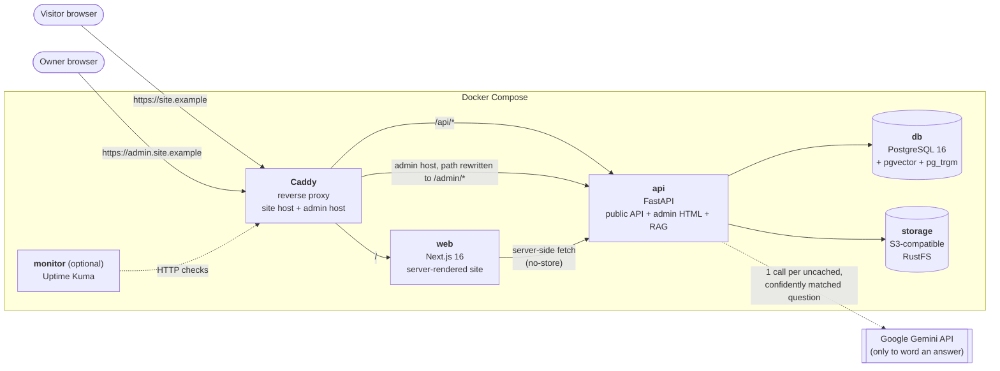
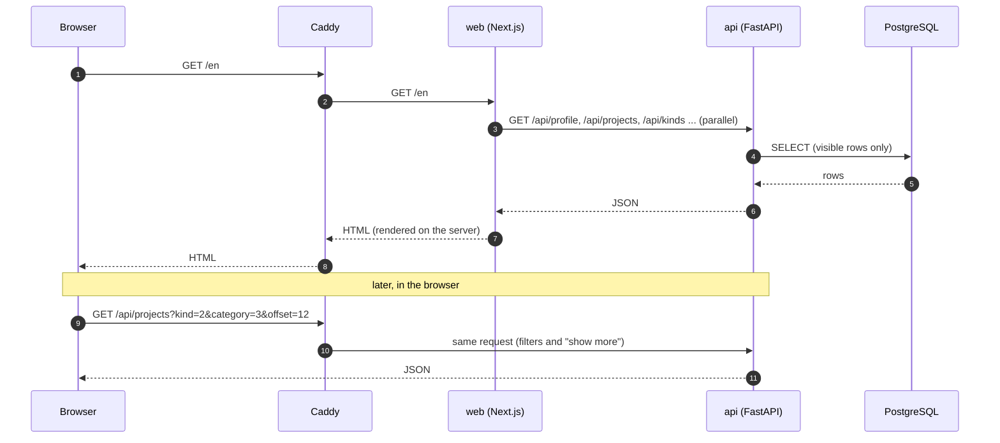
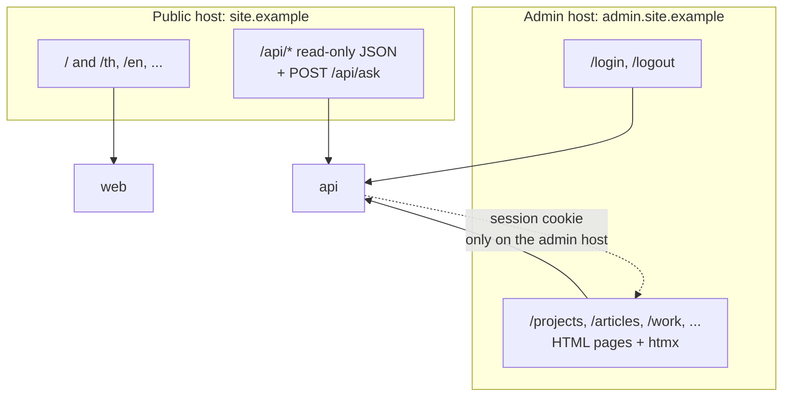
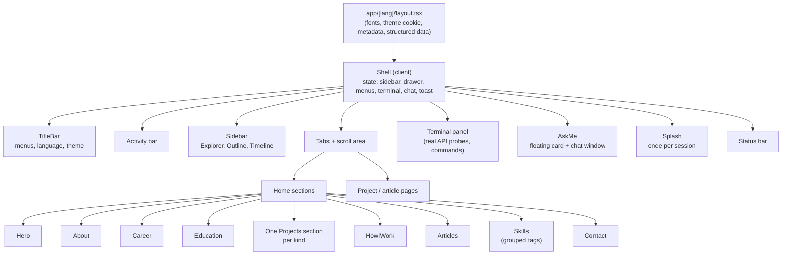
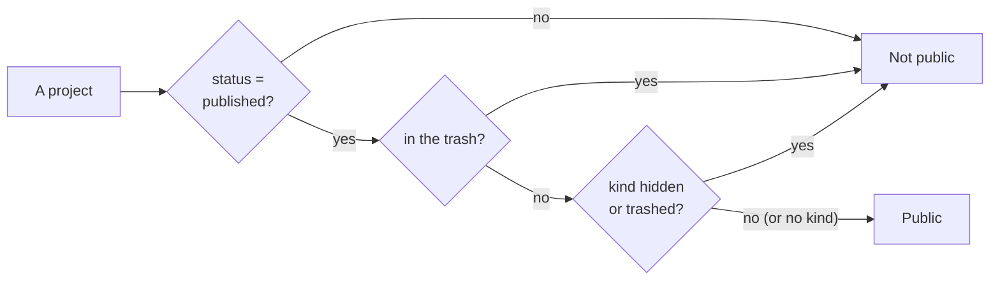
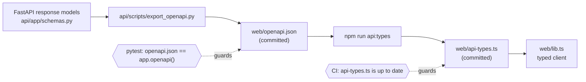
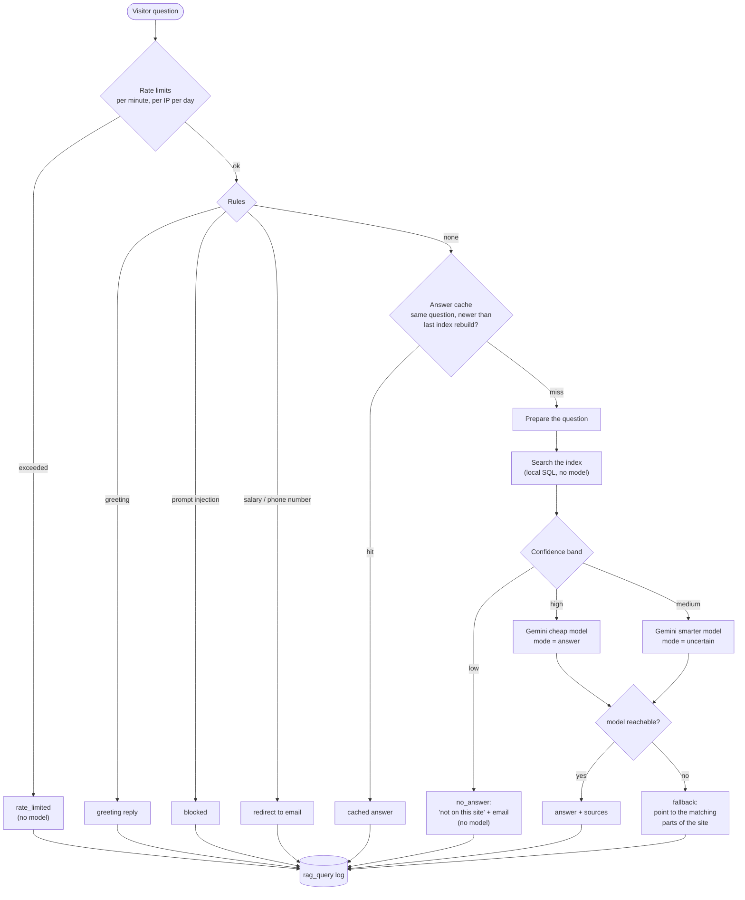
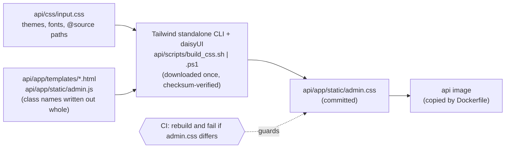
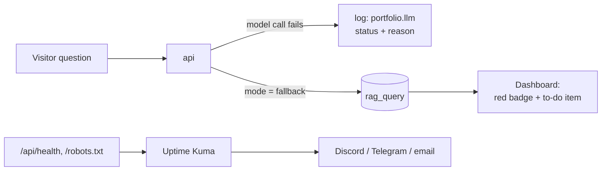

# Portfolio

A bilingual (Thai / English) personal portfolio website with a private back office and a built-in
**"ask about me"** assistant that answers visitors' questions *only* from what is published on the site.

The public site looks and behaves like a code editor (explorer, tabs, terminal panel, light/dark themes).
Everything on it comes from one API: the owner edits content in a server-rendered admin, and the site updates on the
next page load. There is no content hard-coded in the front end.

[](https://github.com/wachirawitraksa/portfolio/actions/workflows/ci.yml)


---

## Table of contents

1. [What it does](#1-what-it-does)
2. [Architecture](#2-architecture)
3. [Technology](#3-technology)
4. [Repository layout](#4-repository-layout)
5. [The public website](#5-the-public-website)
6. [The API](#6-the-api)
7. [Data model](#7-data-model)
8. [The "ask about me" assistant (RAG)](#8-the-ask-about-me-assistant-rag)
9. [The admin back office](#9-the-admin-back-office)
10. [Security model](#10-security-model)
11. [Configuration](#11-configuration)
12. [Run it locally](#12-run-it-locally)
13. [Development workflow](#13-development-workflow)
14. [Testing and CI](#14-testing-and-ci)
15. [Operations and monitoring](#15-operations-and-monitoring)
16. [Going to production](#16-going-to-production)
17. [Design decisions](#17-design-decisions)
18. [License](#18-license)

---

## 1. What it does

**For visitors**

- Home page with hero, about, work history, education, projects, articles, skills and contact, in **Thai or English**
  (a language switch, and the URL carries the language: `/th`, `/en`).
- Projects are grouped **by kind**: project, certificate, award, course, activity... The owner defines the kinds, so
  the site gets a section per kind automatically. Each section has category filters and "show more".
- Detail pages for every project and article (Markdown for articles), image galleries, repo/demo/verify links.
- A "how I work" section that tells the story through one real project the owner picks.
- **ASK Me**: a chat window (and a terminal command) that answers questions about the owner using only site content,
  always citing which project, job or article the answer came from.
- Dark and light themes, a boot splash, keyboard shortcuts, a sitemap, Open Graph tags and structured data.

**For the owner**

- A private admin to manage everything: profile (photo, CV in two languages, contact links), projects of any kind,
  work history, education, articles, categories, kinds, technology tags, a glossary for the assistant, display settings.
- Draft / published / hidden per item, featured items, manual ordering, a **trash** with restore, and a "preview on the
  site" link that shows a draft on the real website for a few minutes.
- A dashboard that shows what needs attention: stale search index, missing translations, failing model calls,
  unanswered visitor questions.
- Login with password + TOTP, optionally GitHub.

**Content rules built in**

- Every text field exists in two languages. A missing translation never blocks publishing: the site shows the other
  language and the admin flags the gap.
- Nothing is a fixed list in code: the number of projects, the kinds, the categories and the skill groups all come from
  the database, and the pages stay sensible with 3 items or 60.

---

## 2. Architecture

Three kinds of container sit behind one reverse proxy. The browser only ever talks to the proxy.



Key points:

- **The front end never touches the database.** `web` reads the public JSON API over HTTP, nothing else. Its TypeScript
  types are generated from the API's OpenAPI document, so a field renamed in Python becomes a compile error in the site.
- **One service owns the data**: `api` owns PostgreSQL, object storage, authentication, business rules and the whole
  question-answering pipeline.
- **Two hosts, two surfaces.** The public host serves the site (`/`) and the read-only API (`/api/*`). The admin lives on
  a *different host name*; Caddy rewrites it to `/admin/*` inside the API. The admin is therefore unreachable from the
  public host, session cookies are scoped to the admin host, and the admin host can later be restricted to an IP or VPN
  without touching the public site.
- **The model is optional.** Search, caching, rules and fallbacks all run without it; the language model is called last,
  once, and only to phrase an answer.

### How a request travels



### Public API versus admin



---

## 3. Technology

| Layer | What | Why |
|---|---|---|
| Public site | **Next.js 16** (App Router, React 19, TypeScript), **Tailwind CSS 4** | Server-rendered pages from a typed API; fonts self-hosted (`@fontsource`) so the build needs no external network |
| API | **FastAPI**, Pydantic, **SQLAlchemy 2** (async) + **asyncpg**, **Alembic** | One migration chain; response models double as the OpenAPI contract |
| Database | **PostgreSQL 16** with **pgvector** and **pg_trgm** | Relational content plus vector and fuzzy text search in one place |
| Object storage | **RustFS** (S3-compatible) via `boto3` | Images and CVs; endpoint and keys come from environment variables, so a real S3 service drops in later |
| Admin UI | **Jinja2** + **htmx** (`hx-boost`), **Tailwind CSS 4** + **daisyUI 5** | No JavaScript build in the API container; CSS is generated by the Tailwind standalone CLI and committed |
| Thai language | **PyThaiNLP** | Normalisation, word segmentation and romanisation for question handling |
| Images | **Pillow** | On-demand resized WebP copies (`?w=480`) |
| Assistant | Hashed bag-of-words + character-trigram embeddings (local), **Google Gemini** to phrase answers | Search needs no API; the model is behind one small adapter |
| Auth | `argon2-cffi` (password), `pyotp` (TOTP), GitHub OAuth (allow-listed) | See [Security model](#10-security-model) |
| Proxy | **Caddy 2** | Host-based routing, automatic HTTPS in production |
| Monitoring | Docker healthchecks, dashboard alerts, optional **Uptime Kuma** | See [OPERATIONS.md](OPERATIONS.md) |
| CI | **GitHub Actions** | Tests, type check, build, stale-asset check |

---

## 4. Repository layout

```text
.
├── docker-compose.yml        # the whole stack: caddy, web, api, db, storage (+ optional monitor)
├── Caddyfile                 # host-based routing (site host, admin host)
├── OPERATIONS.md             # monitoring, alerting, CI failures and how to fix them
├── PLAN.md                   # original product brief and decisions (Thai)
├── .github/workflows/ci.yml  # CI
│
├── api/                      # Python back end
│   ├── app/
│   │   ├── main.py           # app assembly: /api/* public, /admin/* private
│   │   ├── models.py         # SQLAlchemy models (the data model)
│   │   ├── schemas.py        # public response models (become OpenAPI)
│   │   ├── config.py         # settings from environment variables
│   │   ├── visibility.py     # the one rule for "what the public may see"
│   │   ├── security.py, sessions.py, deps.py, ratelimit.py   # auth, CSRF, limits
│   │   ├── imaging.py        # resized image variants
│   │   ├── previews.py       # signed, short-lived draft-preview links
│   │   ├── routers/          # public.py (read API), ask.py, health.py, and one admin router per resource
│   │   ├── rag/              # the assistant: text, search, policy, llm, index, ask
│   │   ├── templates/        # Jinja2 admin pages; _ui.html holds the shared look
│   │   └── static/           # admin.css (generated), admin.js, htmx, fonts
│   ├── alembic/versions/     # migrations 0001 ... 0013
│   ├── css/input.css         # Tailwind + daisyUI source for admin.css
│   ├── scripts/              # create_user, export_openapi, build_css
│   └── tests/                # pytest suite (runs against a real Postgres)
│
└── web/                      # Next.js front end
    ├── app/
    │   ├── [lang]/           # /th and /en: layout, home, projects/[id], articles/[id]
    │   ├── sitemap.ts, robots.ts
    ├── components/           # IDE shell (title bar, sidebar, terminal, ASK Me) and page sections
    ├── lib.ts                # typed API client (server-side and browser)
    ├── api-types.ts          # GENERATED from openapi.json
    ├── openapi.json          # snapshot of the API contract (checked by a test)
    ├── proxy.ts              # redirects "/" and unprefixed paths to /th
    └── i18n.ts               # UI strings (content always comes from the API)
```

---

## 5. The public website

### Routes

| Route | Content |
|---|---|
| `/` and any path without a language | redirected to `/th` (`proxy.ts`) |
| `/th`, `/en` | the home page: every section, built from the API |
| `/{lang}/projects/{id}` | one project, certificate, award... with gallery and outline |
| `/{lang}/articles/{id}` | an article written on the site (Markdown). Articles that live on another platform link out |
| `/{lang}/projects/{id}?preview=<token>` | a draft, for the owner only (see [previews](#previews)) |
| `/sitemap.xml`, `/robots.txt` | generated from the API |

### The editor-style interface

The site is one persistent "IDE" shell that wraps every page:



- **Sections appear only when they have content.** The explorer, outline, menus and page share one rule
  (`shell-data.ts`), so an empty section is not a broken block.
- **Responsive.** Above 900 px it is the full editor; below it the sidebar becomes a drawer; on phones the layout is
  single-column. The page itself never scrolls sideways.
- **Terminal panel.** Opens with `Ctrl+J`. On first open it types `npm run boot` and runs *real* requests against the
  API (`/api/health`, `/api/profile`, `/api/projects`), printing status codes and timings. It also understands
  `ls`, `cd`, `open`, `theme`, `lang`, `ask <question>`, `whoami`, `clear`, `exit`.
- **Theme** is a cookie read on the server, so the first paint already has the right colours (no flash).
- **Boot splash** shows once per browser session and never for users who prefer reduced motion.

### Rendering and data fetching

- Pages are rendered on the server. Server-side fetches use `cache: "no-store"`, so a change in the admin shows on the
  next page load.
- Browser-side requests (category filter, "show more", the ASK Me box) use relative `/api/...` URLs, which the proxy
  routes to the API. In `npm run dev` Next rewrites `/api/*` to the API instead.
- Pictures are requested at fixed widths (`?w=480`...) with `srcset`, so a card never downloads the original file.

### SEO

Title and description come from the admin (falling back to the profile), plus canonical and `hreflang` links, Open
Graph tags, JSON-LD (`Person`), `sitemap.xml` and `robots.txt`. Preview pages are marked `noindex`.

---

## 6. The API

Interactive docs: `/api/docs` (Swagger UI). The public API is **read-only** except `POST /api/ask`.

| Endpoint | Purpose |
|---|---|
| `GET /api/profile`, `/profile/photo`, `/profile/cv/{th\|en}` | the owner, photo, CV files |
| `GET /api/settings` | page sizes, featured limit, site title and description, the "how I work" project |
| `GET /api/kinds`, `/categories`, `/tags` | filters; tags carry usage counts and a skill group |
| `GET /api/projects?kind=&category=&tag=&q=&sort=&limit=&offset=` | project list (cards) |
| `GET /api/projects/featured`, `/projects/{id}` | featured cards, full detail with images |
| `GET /api/how-i-work` | the chosen project, or `null` |
| `GET /api/experience`, `/education` | work and education timelines |
| `GET /api/articles`, `/articles/{id}` | articles (Markdown body for site-written ones) |
| `GET /api/updates?limit=` | recent edits, for the sidebar timeline |
| `GET /api/media/{id}?w=` | project image, optionally resized (`320, 480, 640, 960, 1280, 1600`) |
| `GET /api/preview/projects/{id}?token=`, `/preview/articles/{id}?token=` | a draft, with a valid short-lived token |
| `POST /api/ask` | ask a question (see below) |
| `GET /api/health`, `/api/health/live` | readiness (database + storage) and liveness |

Conventions: dates are ISO strings, a missing optional value is `null`, text fields come as `<name>_th` / `<name>_en`.

### What the public may see

One rule, in [`visibility.py`](api/app/visibility.py), used by the API, the image route **and** the search index, so
they cannot disagree:



Work and education entries are public unless hidden or trashed; articles when published and not trashed. Pictures of a
non-public project return 404, and so do their resized copies.

### Previews

A draft can be opened on the real site for ten minutes. The admin mints a token (an HMAC over *kind, id, expiry*) keyed
from the admin's password hash, so it names one item, expires, and dies if the password changes. No extra secret is
configured.

### The contract between API and site



---

## 7. Data model

Created and evolved by Alembic migrations `0001`...`0013`.

```mermaid
erDiagram
    KIND ||--o{ PROJECT : "files under"
    PROJECT }o--o{ CATEGORY : "up to 3"
    PROJECT }o--o{ TAG : "technologies"
    PROJECT ||--o{ PROJECT_IMAGE : "gallery"
    WORK_ENTRY }o--o{ TAG : "tools"
    ARTICLE }o--o{ TAG : "topics"
    SITE_SETTINGS }o--o| PROJECT : "how I work"
    PROFILE ||--o{ CONTACT_LINK : "links"
    USER ||--o{ AUTH_SESSION : "sessions"

    KIND {
        int id
        string name_th
        string name_en
        int sort_order
        bool hidden
        string[] fields "which form groups this kind uses"
    }
    PROJECT {
        int id
        int kind_id
        string title_th_en "title, problem, work, role, result, learned, next_steps in TH + EN"
        string issuer "certificates, awards, courses"
        date issued_on
        string repo_demo_verify_urls
        string[] aliases "alternate names for the assistant"
        string status "draft | published | hidden"
        bool featured
        int sort_order
        datetime deleted_at "trash"
        datetime updated_at
    }
    CATEGORY {
        int id
        string name_th_en
        bool hidden
    }
    TAG {
        int id
        string name
        string[] aliases
        string group_th_en "skills section heading"
    }
    PROJECT_IMAGE {
        int id
        string key "object storage key"
        string caption_th_en
        bool is_cover
        int sort_order
    }
    WORK_ENTRY {
        int id
        string position_th_en
        string employer
        string employment_type
        date started_on
        date ended_on
        bool ongoing
        string bullets_th_en
        bool hidden
    }
    EDUCATION_ENTRY {
        int id
        string institution_th_en
        string level
        string degree_field_th_en
        string grade
        bool ongoing
    }
    ARTICLE {
        int id
        string title_summary_body_th_en
        string source "internal | external"
        string external_url
        string status
        date published_on
    }
    PROFILE {
        int id
        string name_intro_headline_location_th_en
        string email
        string photo_cv_keys
    }
    SITE_SETTINGS {
        int id
        int featured_limit
        int projects_page_size
        string site_title_description_th_en
        int how_i_work_project_id
    }
    GLOSSARY_ENTRY {
        int id
        string[] terms "words that mean the same"
    }
    RAG_CHUNK {
        int id
        string source_type "project | work | education | article | profile"
        int source_id
        string search_text
        vector embedding "384 dims"
    }
    RAG_QUERY {
        int id
        string question
        string mode "answer | fallback | no_answer ..."
        string band "high | medium | low"
        string ip_hash "salted, never the IP"
        json sources
    }
    USER {
        int id
        string email
        string password_hash
        string totp_secret
        int github_user_id
    }
    AUTH_SESSION {
        string id "opaque, server-side"
        string csrf_token
        datetime expires_at
        datetime revoked_at
    }
```



Notes:

- **One table, many kinds.** Projects, certificates, awards, courses and activities share the `project` table. A kind
  decides which groups of fields its admin form shows (`kind.fields`), so a certificate is not asked for a repo link.
- **Soft delete.** Everything user-visible has `deleted_at`; the admin trash restores or permanently deletes.
  Recent edits are tracked in `updated_at` (rows from before that column existed stay `NULL` and are simply left out of the
  "recent updates" list rather than given an invented date).
- **Single-row tables**: `profile` and `site_settings` (id 1, created on first use).

---

## 8. The "ask about me" assistant (RAG)

**Principle: do the work on our side first and give the model as little as possible.** Retrieval is entirely local SQL
and needs no API; the model is only asked to phrase an answer from text we selected.



### Preparing the question

`rag/text.py` and `rag/search.py` normalise Thai and English input before searching:

- Collapse repeated characters and spaces, convert Thai digits, normalise Thai tone marks.
- **Wrong keyboard layout** is detected and reversed with a Kedmanee ↔ QWERTY table (`l;ylfu` is understood as `สวัสดี`).
- **Thai typed in Latin letters** ("tam ngan arai") is matched through a phonetic key.
- Typos in either language are tolerated through trigram similarity.
- **Glossary expansion**: words that mean the same (`สต็อก = stock = inventory`), project aliases, and technology tags with
  their aliases (`pg = PostgreSQL`) are expanded into one concept, so any spelling finds the right text.

### Searching

The site's content is cut into *chunks* (a project, or one section of it; a job; a part of an article; the profile) in
both languages and stored in `rag_chunk`. Each chunk is scored on four signals, all computed in PostgreSQL:

| Signal | How |
|---|---|
| keyword | how much of the question (as concepts) the chunk covers; longer words weigh more |
| trigram | `pg_trgm` word similarity of the whole question |
| vector | cosine similarity of a local hashed embedding (bag of words + character trigrams, 384 dims, works offline, no Thai word segmentation needed) |
| sound | `pg_trgm` on a phonetic key, for Thai typed in Latin letters |

The signals are blended and re-ranked into a **confidence band**: `high`, `medium`, `low`.

### Answering and cost control

- `low` → the site answers directly that the information is not on the site and offers the owner's email. **No model call.**
- `high` → one call to the cheaper model; `medium` → one call to the smarter model and the answer is marked uncertain.
- The prompt contains only the selected chunks and instructs the model to use nothing else, to name its sources, and to
  treat the visitor's text as untrusted. Every answer returns its **sources** (project, job, article), which the chat
  turns into links.
- If the model is unreachable (retired model, quota, outage, no key) the visitor gets `fallback`: a pointer to the matching
  parts of the site, never an error. The failure is written to the log (`portfolio.llm`) and shown on the admin dashboard.
- Repeated questions are served from a cache that is invalidated whenever the index is rebuilt.
- Every outcome is logged (with a **salted hash** of the IP, never the IP) so the owner can see what visitors want that
  the site cannot yet answer. Logs older than `ASK_LOG_DAYS` are deleted automatically.

The index is rebuilt on demand from the admin ("rebuild"); the dashboard says when it is stale. The glossary takes
effect immediately without a rebuild. The model sits behind a one-method adapter (`rag/llm.py`), so another provider can
be added without touching the rest.

---

## 9. The admin back office

Server-rendered HTML for one person, served by the API itself (not by Next.js). Every mutation is a plain form `POST`;
`htmx` boosts navigation so pages swap without a full reload.

| Area | Pages |
|---|---|
| Overview | dashboard: to-do list, system status, question stats, content counts |
| Content | profile (photo, CVs, links), projects/items, work history, education, articles |
| Organising | categories, kinds (with the field groups each uses), technology tags (with aliases and skill group) |
| Question box | status and "try a question" (shows the scores, no model), visitor questions and unanswered ones, glossary |
| System | display settings (page sizes, featured count, site title/description, "how I work" project), trash, account and security, active sessions |

Details worth knowing:

- **Bilingual in one form.** Both languages sit side by side and a missing one is flagged; saving with one language is fine.
- **Two interface languages.** The admin itself is Thai by default with an English mode. Templates are written in Thai
  and translated at the *template-source* level from a catalogue (`i18n.py`), so text the owner typed is never touched.
- **Light/dark themes and a collapsible sidebar** are remembered in cookies and drawn by the server.
- **Forms adapt to the kind.** Choosing "Certificate" hides repo links and shows issuer and date; data typed into a hidden
  group is kept.
- **Images:** multiple per item, cover selection, captions, ordering, trash and restore; the browser never uploads
  straight to storage, the API validates the file type from its bytes and size.
- **Trash:** nothing is deleted at once. Restore, or delete permanently (which also removes files from storage).

### How the admin stylesheet is built

The API container has no Node. The CSS is generated on a developer machine with the Tailwind **standalone CLI** and
daisyUI, and the result is committed:



Shared look (buttons, cards, tables, badges, alerts, forms) is defined once in `api/app/templates/_ui.html`; templates
write `class="{{ ui.btn_primary }}"`. daisyUI classes carry a `d-` prefix so they never clash with the plain class names
used as hooks by `admin.js` and the tests.

---

## 10. Security model

| Concern | Approach |
|---|---|
| Admin authentication | Password (**argon2id**) **plus TOTP**, or GitHub OAuth restricted to an allow-listed GitHub user id attached to the same single user row. OAuth never creates accounts |
| Sessions | Opaque random id in an `HttpOnly`, `SameSite=Lax` cookie (`Secure` when enabled), stored in PostgreSQL, revocable one by one from the admin. Changing the password or resetting TOTP ends every session |
| CSRF | A token on every state-changing request |
| Brute force | Login rate limit per IP; error messages never reveal whether a user exists |
| Surface separation | The admin is only reachable on its own host; the public host cannot route to `/admin` |
| Public API | Read-only; drafts, hidden and trashed items, and their pictures, are not served |
| Assistant | Rate limited per minute and per IP per day; prompt-injection and private-contact requests are handled by rules before any model; the prompt restricts the model to supplied context; IPs are stored only as salted hashes |
| Uploads | File type from magic bytes, size limit, images re-served with `nosniff`; decompression-bomb limit when resizing |
| Secrets | Only from environment variables (`.env`, not committed); the Gemini key never leaves the API |
| Third-party code | None is loaded in the admin; fonts and scripts are self-hosted |
| Draft previews | Signed, expire in ten minutes, tied to one item, void after a password change, `noindex` |

---

## 11. Configuration

All configuration is environment variables, read from `.env` next to `docker-compose.yml`. Nothing is hard-coded, so
moving to a server changes no code.

| Variable | Meaning |
|---|---|
| `SITE_DOMAIN`, `ADMIN_DOMAIN` | host names Caddy serves (dev: `localhost`, `admin.localhost`) |
| `HTTP_PORT` | published proxy port (dev: `8080`) |
| `SITE_URL` | public base URL for sitemap and link previews (defaults to `http://$SITE_DOMAIN`) |
| `POSTGRES_USER`, `POSTGRES_PASSWORD`, `POSTGRES_DB`, `DATABASE_URL` | database |
| `S3_ENDPOINT`, `S3_ACCESS_KEY`, `S3_SECRET_KEY`, `S3_BUCKET` | object storage |
| `MAX_UPLOAD_MB` | upload size limit |
| `COOKIE_SECURE`, `SESSION_DAYS`, `LOGIN_ATTEMPTS_PER_MINUTE` | admin session behaviour (`COOKIE_SECURE=true` behind HTTPS) |
| `GITHUB_CLIENT_ID`, `GITHUB_CLIENT_SECRET`, `GITHUB_REDIRECT_URI` | optional GitHub login (all three, or none) |
| `GEMINI_API_KEY`, `GEMINI_MODEL_CHEAP`, `GEMINI_MODEL_SMART`, `LLM_TIMEOUT_SECONDS` | the assistant's model (without a key it still works in "show me where to read" mode) |
| `ASK_PER_IP_PER_DAY`, `ASK_PER_MINUTE`, `ASK_CACHE_DAYS`, `ASK_LOG_DAYS`, `ASK_IP_SALT` | assistant limits, cache and log retention, and the salt for hashing IPs (**change it**) |
| `TRUST_FORWARDED_FOR` | trust `X-Forwarded-For` from the proxy (disable if the API is ever exposed directly) |
| `WEB_PORT`, `API_PORT`, `DB_PORT`, `S3_PORT`, `MONITOR_PORT` | localhost-only debug ports |

---

## 12. Run it locally

Requirements: **Docker** with Compose v2.

```bash
# 1. Create your .env from the example, then change the values marked "change-me"
#    (database and S3 passwords, ASK_IP_SALT). Add GEMINI_API_KEY to enable the assistant.
cp .env.example .env

# 2. Build and start everything
docker compose up -d --build
docker compose ps                  # wait until api, web and db are "healthy"

# 3. Create the admin user (first time only). It prompts for a password (min. 12 chars)
#    and prints a TOTP secret to add to your authenticator app.
docker exec -it portfolio-api python -m scripts.create_user you@example.com --totp
```

| | URL |
|---|---|
| Public site | http://localhost:8080 |
| Admin | http://admin.localhost:8080 |
| API docs | http://localhost:8080/api/docs |

Database migrations run automatically every time the `api` container starts (`alembic upgrade head`).

After adding content in the admin, open **Question box → Status and try a question → Rebuild** so the assistant can see it.

Useful commands:

```bash
docker compose logs -f api              # follow the API log
docker compose up -d --build api        # apply a code or .env change to one service
docker compose --profile monitor up -d  # optional uptime monitor (see OPERATIONS.md)
docker compose down                     # stop (data stays in volumes)
# docker compose down -v                # DANGER: also deletes the database and uploaded files
```

Data lives in two named volumes: `db-data` (PostgreSQL) and `storage-data` (images and CVs).

---

## 13. Development workflow

### API

```bash
cd api
pip install -r requirements-dev.txt
# the tests need PostgreSQL with pgvector. They create and drop their own tables in portfolio_test:
docker run -d --name pf-test-db -p 5432:5432 \
  -e POSTGRES_USER=portfolio -e POSTGRES_PASSWORD=portfolio -e POSTGRES_DB=portfolio_test pgvector/pgvector:pg16
pytest
```

Set `TEST_DATABASE_URL` to use another database.

- **New migration:** add `alembic/versions/00NN_name.py` and update `app/models.py`; `alembic check` should report no drift.
- **Changed a public response model?** Regenerate the contract and the front-end types:

  ```bash
  cd api && python -m scripts.export_openapi          # writes ../web/openapi.json
  cd ../web && npm run api:types                      # writes api-types.ts
  ```

- **Changed an admin template or `css/input.css`?** Rebuild the stylesheet and commit `app/static/admin.css`:

  ```bash
  api/scripts/build_css.sh          # Git Bash / Linux / macOS
  api\scripts\build_css.ps1         # Windows PowerShell   (add -Watch to rebuild on change)
  ```

  The first run downloads the pinned Tailwind CLI and daisyUI into `api/tools/` (git-ignored, checksum-verified).
  Write class names out in full in templates (never `"btn-" ~ name`): Tailwind reads the files as text.

### Web

```bash
cd web
npm ci
npm run dev        # http://localhost:3000, needs the API on http://localhost:8000
                   # (set API_INTERNAL_URL to point elsewhere; /api/* is rewritten to it in dev)
npm run build      # regenerates api-types.ts, then builds
```

---

## 14. Testing and CI

- **API:** a large `pytest` suite that runs against a real PostgreSQL (with pgvector and pg_trgm), covering the public
  API, every admin route, auth and sessions, CSRF, visibility rules, images, previews, the assistant (text handling,
  search, policy, caching, limits, fallbacks) and the admin's English translation.
- **Contract tests:** `web/openapi.json` must equal the running API's OpenAPI document.
- **CI** (`.github/workflows/ci.yml`) runs on every push to `main` and every pull request:

| Job | Checks |
|---|---|
| `api` | `pytest`; the committed `admin.css` equals a fresh build from the templates |
| `web` | `api-types.ts` is current; `tsc`; `next build`; `npm audit` (production dependencies, high severity) |
| `images` | both Docker images build |

Actions are pinned to commit SHAs. See [OPERATIONS.md](OPERATIONS.md) for what to do when a job fails.

---

## 15. Operations and monitoring

Three layers, described in [OPERATIONS.md](OPERATIONS.md):

1. **Docker healthchecks** on `api`, `web` and `db` (`docker ps`).
2. **The admin dashboard** flags a failing model (a red badge and a to-do item counted from the question log), a stale
   search index, unreachable database/storage, and unanswered questions.
3. **Uptime Kuma** (optional compose profile) for alerts to Discord, Telegram or email, with the recommended monitors
   (`/robots.txt`, `/api/health/live`, `/api/health`, the admin login).



---

## 16. Going to production

The stack is built so that moving to a server changes configuration, not code. The repository includes a production kit:

- `docker-compose.prod.yml` - restart policy, log rotation, ports 80/443, certificate volumes; only the proxy is exposed.
- `Caddyfile.prod` - automatic HTTPS for the two host names, security headers, optional admin IP restriction.
- `.env.production.example` - template for the server's `.env`; `ops/gen-secrets.sh` fills in random secrets.
- `ops/backup.sh`, `ops/verify-backup.sh`, `ops/restore.sh` - backups of the database and uploaded files, a check that a
  backup really restores, and the restore itself.

**[DEPLOY.md](DEPLOY.md)** is the step-by-step procedure (DNS, server, first start, backups, updates, checklist) and
says exactly what was verified locally and what can only be verified with a real domain. Add an **external** uptime
check as well: Uptime Kuma on the same host cannot alert if the whole host is down.

---

## 17. Design decisions

- **Admin outside Next.js.** The admin is plain server-rendered HTML in the API. That keeps the whole login path out of the
  public site's runtime, removes a JavaScript build from the back end, and makes it possible to lock the admin host down
  independently.
- **One migration chain, one owner of data.** Only the API talks to PostgreSQL. The site is a typed HTTP client.
- **Search before model.** Retrieval, rules, caching and limits are local; the model is the last, optional, single step.
  This keeps the assistant cheap, fast to fall back, and honest ("not on this site").
- **No hard-coded content structure.** Kinds, categories, tags and skill groups are data, so adding a new type of work
  needs no deployment.
- **Honest data.** The site never invents numbers or dates: empty sections are hidden, untracked timestamps are left out,
  skill counts are "how many public projects use it", not a rating.
- **Deterministic builds.** The admin CSS is generated by a pinned, checksum-verified tool with explicit sources, and CI
  rejects a stale file.

---

## 18. License

[MIT](LICENSE) © 2026 Wachirawit Raksa

Third-party code and fonts that ship in this repository keep their own licenses; see [THIRD_PARTY_LICENSES.md](THIRD_PARTY_LICENSES.md).
